# my-split-keyboard 

### Finished Product Showcase
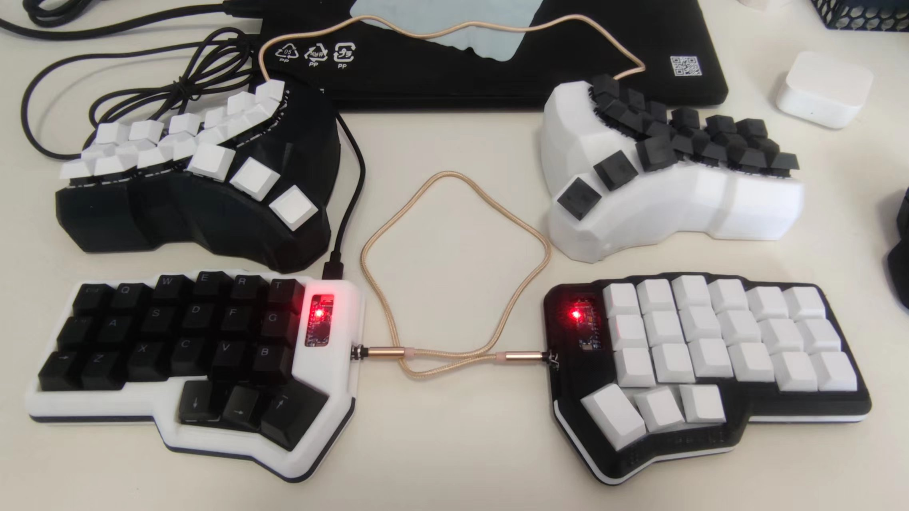

- The keyboard layout has three layers:
  - Layer 1: Default regular alphabet keys, indicated by the top-left annotation in the image
  - Layer 2: Long-press the left Fn key to switch primarily to numeric keys and arrow keys, indicated by the center annotation in the image
  - Layer 3: Long-press the right Fn key to switch primarily to F1-F12 function keys and mouse mode (annotations starting with 'm'), indicated by the bottom-right annotation in the image

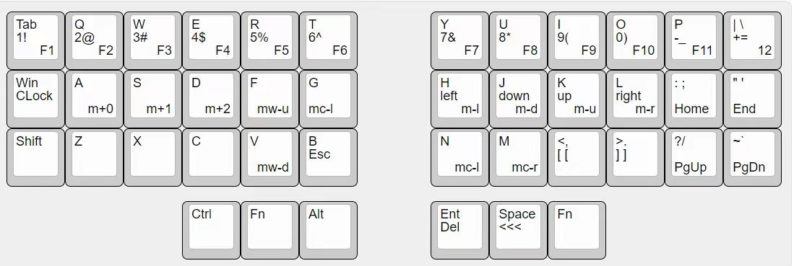

### Preparation
- Hardware:
  - One 3D printer, plus printing materials
  - One soldering iron, plus solder wire
  - Microcontrollers: Two Pro Micro Atmega32u4 boards
  - One USB ISP programmer
    - Used to flash the bootloader onto the microcontrollers
  - Diodes (buy 100 extra just in case)
  - Dupont jumper wires (for testing before soldering)
  - PJ313 5-pin (3-pole) solderless headphone jacks, at least two (buy extra just in case)
  - 3-pole headphone cable
    - Buying a couple extra costs only a few dollars
  - Anti-slip pads
    - Printed keyboard cases tend to slip on tables
  - Screws + nuts, sizes M2.0 to M3.5,
    - Buy several extra of each size, as different 3D models may require different sizes (I had to buy all sizes to find the right fit)
  - Tweezers (at least one pair)
  - Switches and keycaps. Since I don't know how to design PCBs, I soldered traces manually to the switches. To save money, I went with the budget Shenzhan Gray Wood V4 switches
  - Hands (at least a pair!)

- Software:
  - QMK MSYS: Used to compile firmware. You can pick a suitable layout, manually modify it to your preferred keybindings, and then compile
  - avrdudess: Used with the USB ISP programmer to flash the bootloader onto the Atmega32u4
  - QMK Toolbox: Used to flash the compiled firmware onto the Atmega32u4
  - VIA: Optional, if your compiled firmware supports VIA for key remapping. (I didn't use it)

- Websites / Resources:
  - [https://kbfirmware.com/](https://kbfirmware.com/) 
    - Can be used to generate firmware for standard integrated keyboards. Does not support split keyboards
  - [http://www.keyboard-layout-editor.com/#/](http://www.keyboard-layout-editor.com/#/) 
    - Use alongside kbfirmware to generate a layout JSON, which can be used to sketch out your layout
  - [https://docs.qmk.fm/#/keycodes?id=keycodes-overview](https://docs.qmk.fm/#/keycodes?id=keycodes-overview) 
    - QMK Documentation
  - [https://github.com/gsihaj5/qmk_firmware](https://github.com/gsihaj5/qmk_firmware) 
    - QMK Firmware Source Code
  - [https://github.com/sparkfun/SF32u4_boards](https://github.com/sparkfun/SF32u4_boards) 
    - 32U4 Bootloader
  - [https://www.printables.com/model](https://www.printables.com/model) 
    - Download 3D model files
  - [https://www.thingiverse.com/](https://www.thingiverse.com/) 
    - Download 3D model files
  - [https://www.printables.com/model/540985-corne-keyboard-high-profile-case-with-integrated-p](https://www.printables.com/model/540985-corne-keyboard-high-profile-case-with-integrated-p) 
    - The 3D model I personally used. Another model is named "dactyl"; I couldn't find the original link, so just search for the keyword
  - [https://www.printables.com/model/34277-custumizable-solderless-wire-termination-with-pin-](https://www.printables.com/model/34277-custumizable-solderless-wire-termination-with-pin-) 
    - Can be used to mount the microcontroller. Print at 50% height, cut the microcontroller's pins in half, and it fits perfectly. Secure it with superglue or similar adhesive
  - [https://www.printables.com/model/432013-dactyl-cc-v2-promicro-holder](https://www.printables.com/model/432013-dactyl-cc-v2-promicro-holder)
    - Also used to mount the microcontroller, but designed for Dactyl-style cases
  - Some interesting 3D models (Dactyl layouts can be configured and generated online)
    - [https://github.com/atsuyuki/dactyl-manuform-skeleton-edition-4x5](https://github.com/atsuyuki/dactyl-manuform-skeleton-edition-4x5)
    - [https://github.com/diimdeep/awesome-split-keyboards](https://github.com/diimdeep/awesome-split-keyboards)
    - [https://github.com/yejianfengblue/dactyl-generator-demo](https://github.com/yejianfengblue/dactyl-generator-demo)
  - [https://monkeytype.com/](https://monkeytype.com/)
    - Typing practice tool to get familiar with the keyboard layout

### Getting Started
#### Compile the Firmware

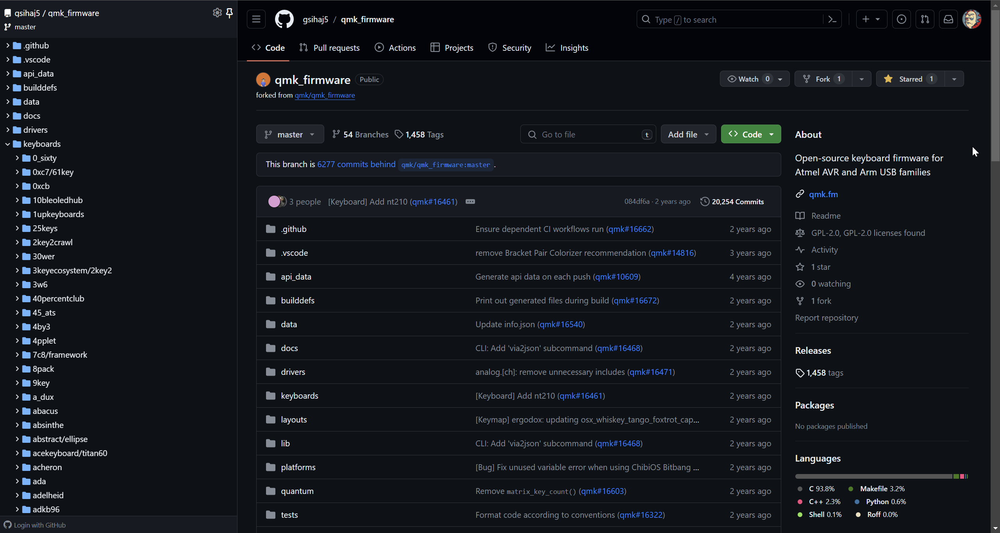

- Install QMK MSYS. The QMK source code contains many firmware templates. I based mine on splitkb/aurora/corne

[keymaps](./splitkb/aurora/corne/keymaps/custom_01/keymap.json)

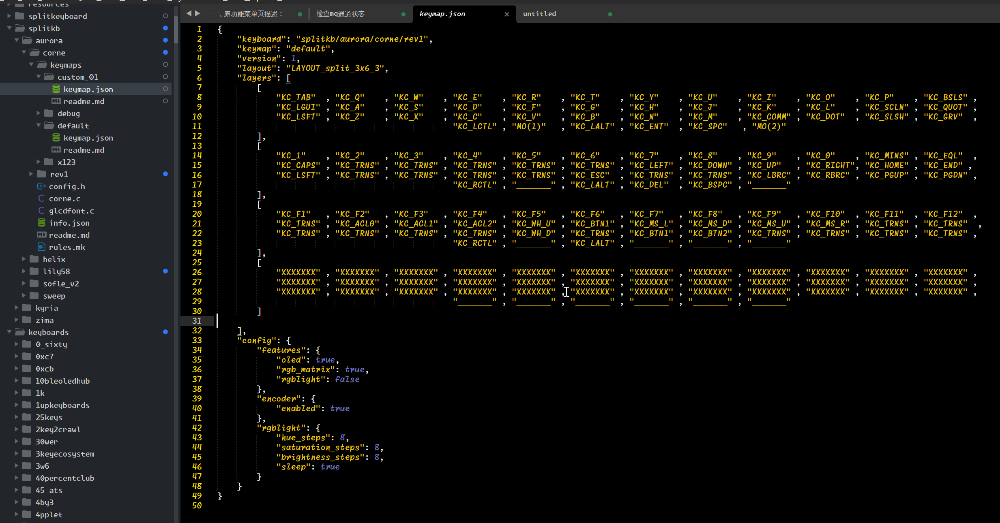

- Run the following command in QMK MSYS to generate the firmware: qmk compile -kb splitkb/aurora/corne -km custom_01
- If all status messages show 【ok】, it compiled successfully

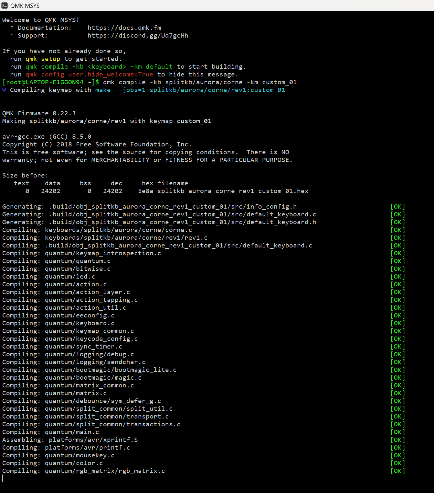

- The output firmware file will be: splitkb_aurora_corne_rev1_custom_01.hex

#### Flash the Bootloader
- Wiring

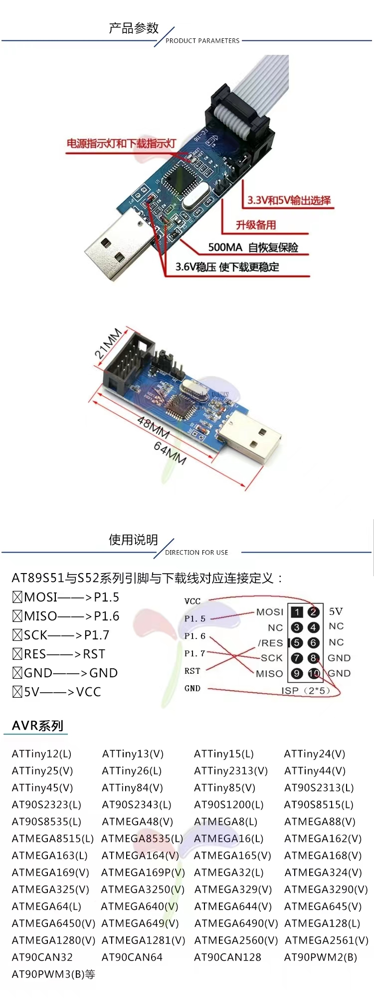
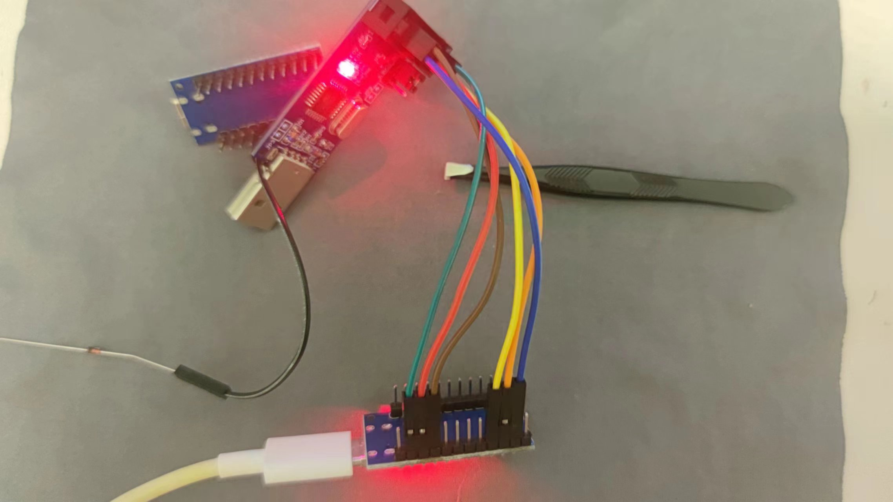

- Connect to PC, open avrdudess, and flash the bootloader 【Caterina-promicro16.hex】
> Follow my configuration settings:

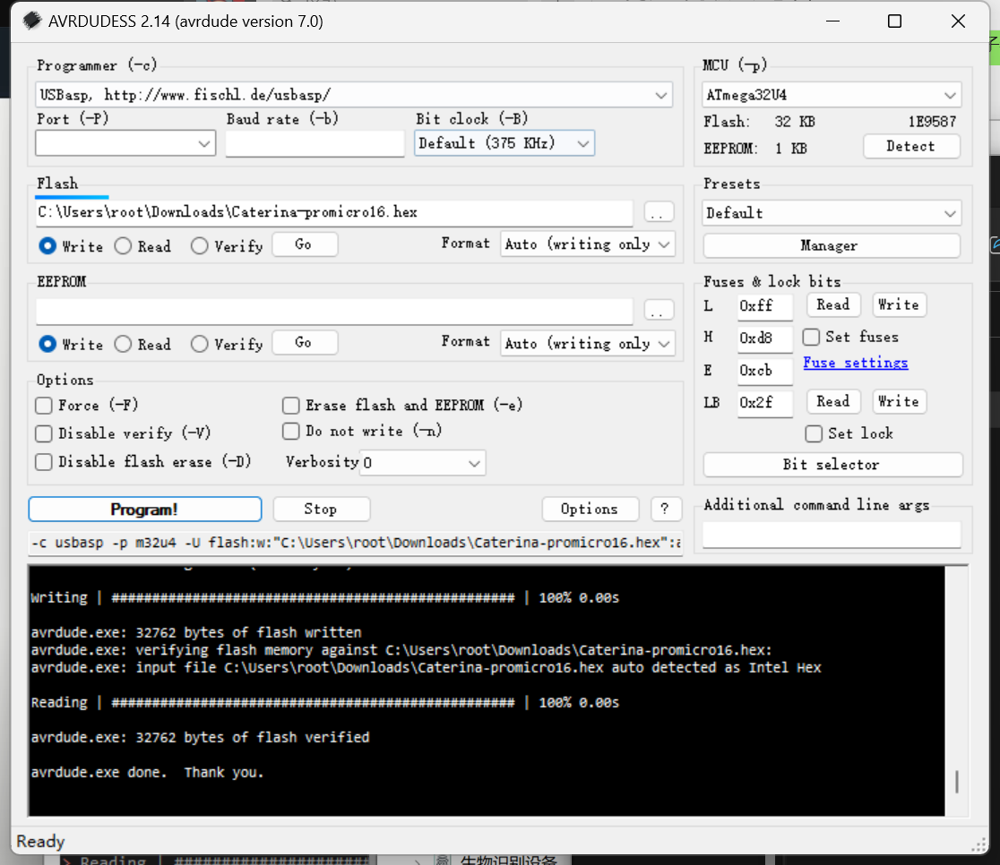

- Switch to a data cable, connect the Atmega32u4, and flash the firmware 【splitkb_aurora_corne_rev1_custom_01.hex】

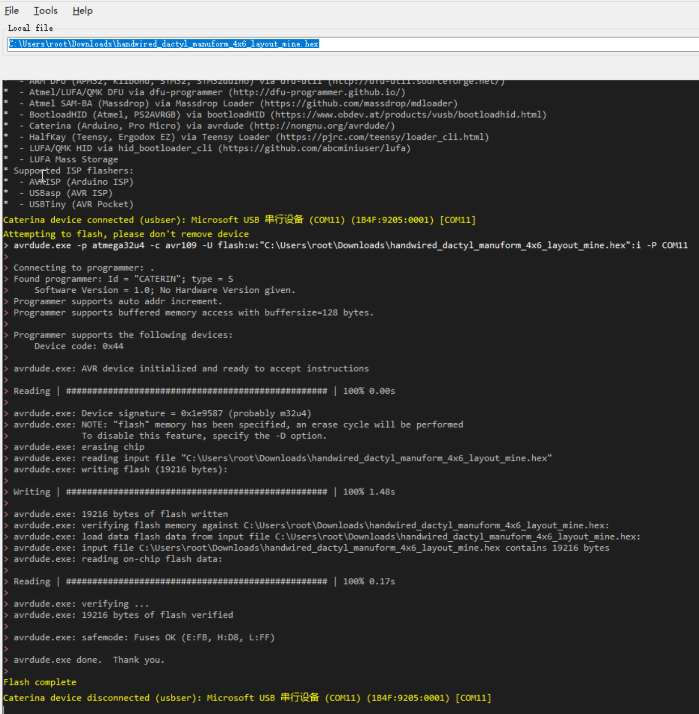

#### Testing & Wiring

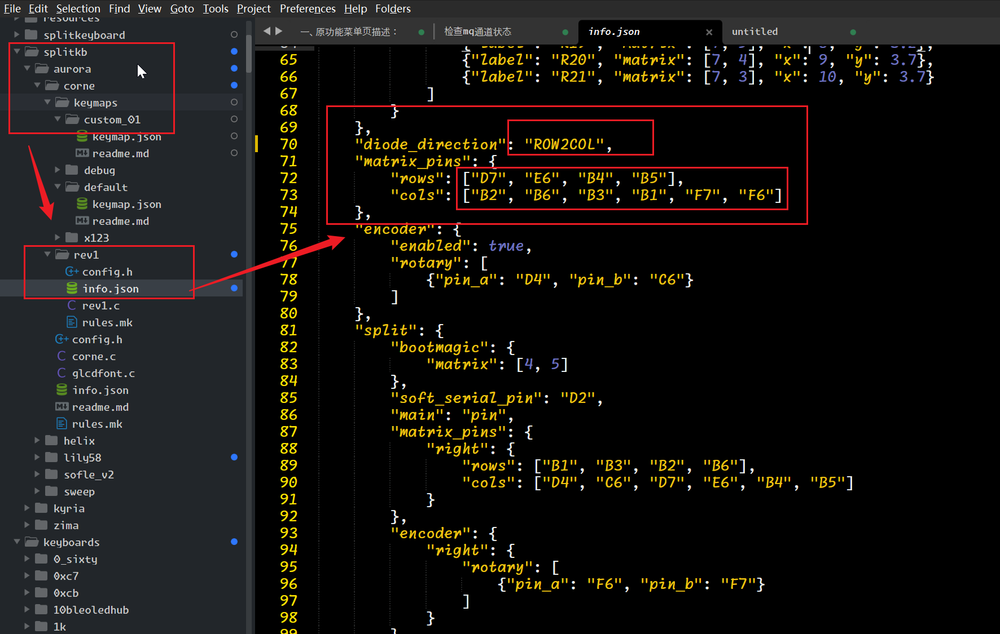
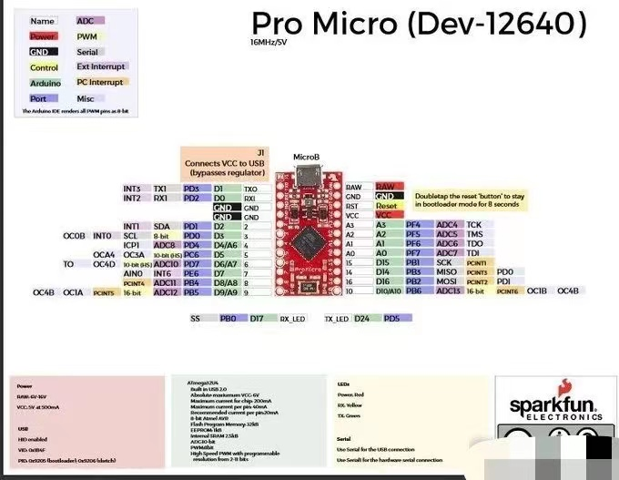
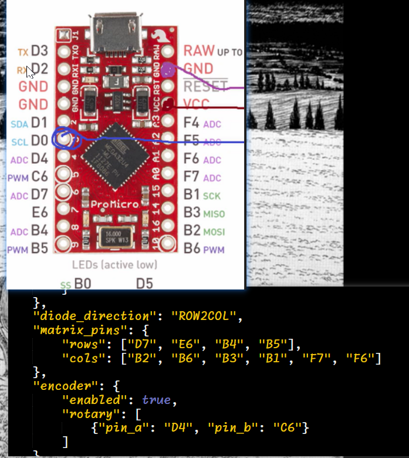
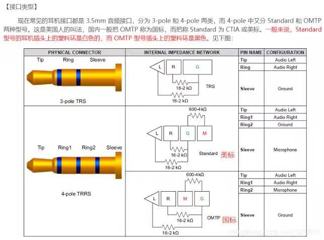
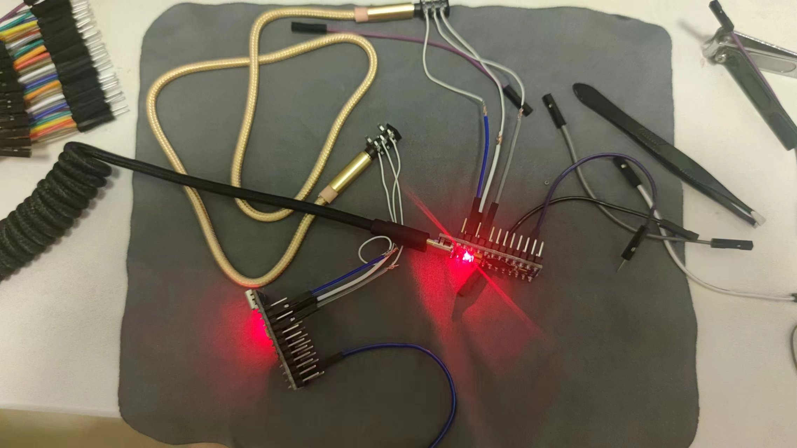
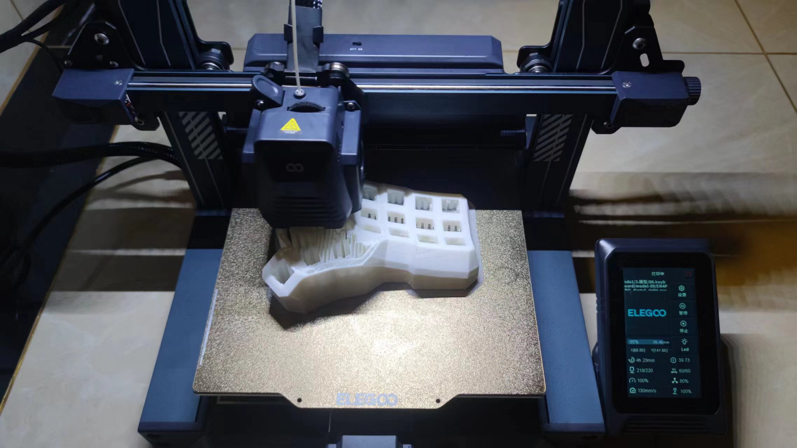
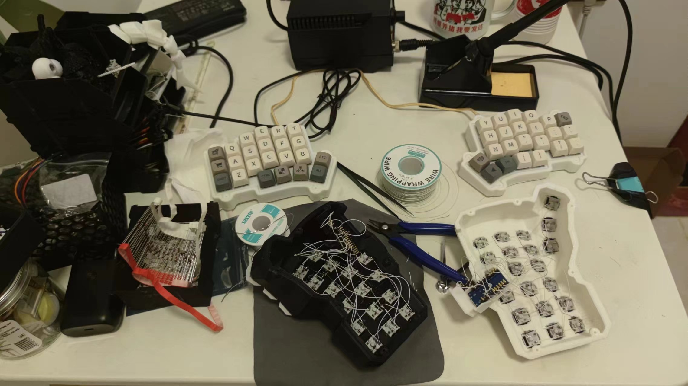
